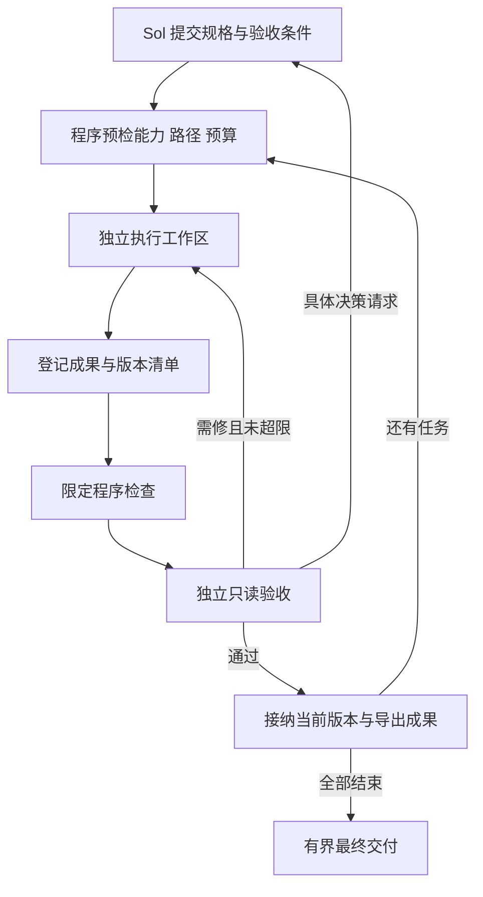

# 项目计划优化 v0.3（2026-10-07）

状态：**v0.3 工程运行时仍是设计；v0.2.1 底座已实施修复，验收见 HARDENING_VALIDATION.md。** 本文件保留 2026-10-07 设计历史，并增加 2026-10-08 的审计修正。工程能力、权限隔离和节省比例仍不能凭计划宣称完成。

本次授权范围是参考真实 GitHub 实现优化项目计划，并说明当前业务对话如何处理。没有安装上游软件、改变登录和模型设置、重启服务、修改业务仓库或向另一个对话发送消息。

## 1. 保留目标，修正交付方式

目标仍为：Sol 制定任务和验收条件；已授权原生执行者工作；独立监察读取实际成果；普通程序负责派发、等待、有限返工、状态与恢复。完整执行历史外存，主脑仅接收必要增量。

原交接已经要求输出进入主脑前由程序限制。问题在于 v0.2 只接通新文本工件，尚不能承接现有仓库修改与测试；当前高校岗位项目因此走了另一套直接协作流程。不能把前者的隔离测试移用为后者的保证。

必须区分三种状态：

| 运行方式 | 当前能力 | 能声称的保证 |
| --- | --- | --- |
| `managed_text_v02` | 已验证的文本/CSV/JSON 流程 | 仅经过既有控制器的状态回报有程序大小限制 |
| `managed_repo_v03` | 待实现的工程流程 | 验收前不能声称可派发、可隔离、可恢复 |
| `external_native_collaboration` | 当前高校岗位业务使用的内置子代理流程 | 独立会话与短回报指令；没有本控制器覆盖全部输入的硬保证 |

**模型澄清：** 原业务的工程作者和验收者实际都是 `gpt-6-luna / max`，主脑是 `gpt-6.1-sol / ultra`。此前写死 `low` 的是本项目适配器，内置子代理没有使用该适配器。v0.2.1 已允许路由指定 `reasoning_effort`，核对模型目录、thread/start 返回档位和 turn/start 下传值；不支持或不匹配时停止。真实自检与替身验证分别记录。

## 2. GitHub 参考与采用边界

2026-10-07 读取默认分支提交后固定以下版本。只读核查了相关代码和文档，未在本机安装或执行上游项目。来源登记见 `evidence/plan-optimization-20261007/github-references.json`。

| 项目与固定版本 | 已检查的机制 | 本项目采用的思路 | 保留的区别 |
| --- | --- | --- | --- |
| LightWorker `01698c6e44f6a6ff783a7cca9bae697d2a76dae3` | 任务能力、模型/思考档、路径校验；独立 worktree；持久派发票据 | 派发前能力匹配、范围绑定、工程工作区隔离 | 不采用其代理/网关作为新模型通道；非 Git 项目另做输入清单快照 |
| Paperclip `99a9de9940bf5974352d9dbfbb2f21e62e89689f` | 不同作者审查策略；依赖就绪去重；无进展重复唤醒抑制 | 状态变化驱动审查、程序去重、减少无新信息的主脑回合 | 保留现有 SQLite，不再部署第二个权威调度库；不增加 AI watchdog |
| context-mode `c396a2377a291903cc84f2628682b64848556a2e` | UTF-8 字节预算；按代理区分的检索频率限制；Codex hooks 边界 | 大输出外存、显式检索、字节和频率分别限制 | 不直接安装插件，不启用额外自动记忆；主保证来自我们自己的回报接口 |

对应源码：

- [LightWorker 任务校验](https://github.com/ncepuee/LightWorker/blob/01698c6e44f6a6ff783a7cca9bae697d2a76dae3/lightworker/policy.py)、[工作区隔离](https://github.com/ncepuee/LightWorker/blob/01698c6e44f6a6ff783a7cca9bae697d2a76dae3/lightworker/worktree.py)、[模型参数下传](https://github.com/ncepuee/LightWorker/blob/01698c6e44f6a6ff783a7cca9bae697d2a76dae3/lightworker/worker.py)、[原生子代理桥](https://github.com/ncepuee/LightWorker/blob/01698c6e44f6a6ff783a7cca9bae697d2a76dae3/docs/CODEX_NATIVE_BRIDGE.md)。
- [Paperclip 独立审查规则](https://github.com/paperclipai/paperclip/blob/99a9de9940bf5974352d9dbfbb2f21e62e89689f/server/src/services/issue-review-policy.ts)、[依赖唤醒去重](https://github.com/paperclipai/paperclip/blob/99a9de9940bf5974352d9dbfbb2f21e62e89689f/server/src/services/issue-dependency-wakeups.ts)、[无进展唤醒抑制](https://github.com/paperclipai/paperclip/blob/99a9de9940bf5974352d9dbfbb2f21e62e89689f/server/src/services/issue-rewake-throttle.ts)。
- [context-mode 字节处理](https://github.com/mksglu/context-mode/blob/c396a2377a291903cc84f2628682b64848556a2e/src/truncate.ts)、[检索频率限制](https://github.com/mksglu/context-mode/blob/c396a2377a291903cc84f2628682b64848556a2e/src/search/flood-guard.ts)、[Codex hook 限制](https://github.com/mksglu/context-mode/blob/c396a2377a291903cc84f2628682b64848556a2e/src/adapters/codex/hooks.ts)。

不能照搬的三个细节：

1. LightWorker 原生子代理桥仍要求活跃父代理调用 spawn、确认启动和上报结果。它提供持久控制契约，但不能单靠安装就把父对话移出协调循环。未确认派发的租约过期也不能直接重派：必须先对账真实线程和副作用。
2. Paperclip 的审查身份约束与文件只读权限是两件事。我们仍需验收者的只读成果视图与独立测试目录。
3. context-mode 的 `truncateJSON` 明确用于展示，截断结果不保证仍是有效 JSON；Codex hooks 源码也注明 PostToolUse 输出改写受限。我们使用完整 JSON 分页/外存引用，不剪断数据契约，不把 hook 当所有回报路径的保证。

这些是对源码的取舍判断，未证实任何上游节省比例。`src/store.ts` 的连接器读取受限，未作为已读实现证据；外存检索的产品说明与已核查的字节/频率模块分开记录。

## 3. 派发前必须固定的执行契约

新增契约必须由程序校验，而非只写在提示词中：

- 项目 ID、规格版本、任务 ID、请求去重 ID，以及直接用户授权或已授权任务范围的引用。
- 绝对 `project_root`、冻结输入清单、执行工作区、只读验收视图、验收者临时目录、允许修改的相对路径。
- 任务类型：`artifact_text`、`public_source`、`repo_patch`；明确所需能力和选定路由实际具备的能力。
- 原生客户端、请求模型、请求思考档、可观察的实际下传参数和版本。不能悄悄降档、换账号、切新付费 API。
- 验收条件、允许的检查命令 ID、显式公开来源、网络策略、超时、最大尝试次数、总角色回合预算。
- 回报预算、增量游标、决策分页、计划版本及修改范围的摘要哈希。

不支持任务类型、原生接口受阻、模型/思考档不匹配、预算不足时，返回具体预检失败；独立任务继续推进。切入外部内置代理流程时，明确记录其运行方式和保证边界，不能沿用 managed 模式的验收标签。

`v0.3-execution-contract.example.json` 是不可派发的未来格式样例，不能提交给现有 v0.2 入口。当前用户登录授权仍按已有会话事实处理；本计划文件不替独立会话创造凭据权限。

## 4. 普通程序拥有整个工程闭环

权威状态仍在现有控制器的 SQLite 中。工作目录、审查报告和 JSON 导出是证据或投影。既有 v0.2 项目不能因增加字段被当作已经完成 v0.3 工程验收。

工程执行先支持 Codex 原生 Luna、可配置 `max`，保留现有订阅；WorkBuddy 的免费 DS 继续用于已验证的文本/材料任务，不能因模型名字相同就宣称已经具备工程工具。

v0.3 第一版工程流程仅支持干净且已经提交的 Git 基线，优先复用适用的独立 worktree。遇到未提交或非 Git 输入，先返回具体预检失败；经用户授权完成输入快照、基线提交与清单验证后再进入该流程。不能把一次目录复制等同于已定义 patch/revert 语义。未经授权不自动 stash、初始化仓库或丢弃未保存内容。本轮用户已授权 Git 修复，因此建立 baseline-v0.2 和隔离修复分支。

执行者只处理限定工作区；验收者不能修改被审成果、验收标准或主脑状态。测试缓存可写独立临时目录。模型可调用的接口与普通检查进程都要验证实际权限；命令列表和路径检查不能代替 OS/原生沙箱约束。越界写/网络探测未被有效拒绝前，工程隔离状态保持 PARTIAL/BLOCKED。

验收判定绑定 task、spec、attempt、输入清单、成果清单、检查记录和 reviewer 身份。作者 READY、数据事实 PASS、工程使用 PASS 分开。最终接纳前再读实际文件和哈希；生产导出也由程序完成。

2026-10-08 全面审计追加以下前置条件：

- 所有任务状态写入、失败回调、租约续期、接纳和预算预留都校验当前 owner/attempt/spec；在取得 SQLite 写锁后再检查。旧执行尝试返回只能留下自己的日志，不能改变新尝试。未知副作用仍先对账。
- 项目与主脑的调用预算必须在同一 `BEGIN IMMEDIATE` 事务中检查并预留；失败、超时和不确定派发仍占用预留额度。主脑规划、审查、通知都计入相应角色与项目预算。
- 判定键包含冻结输入与成果、检查程序/检查清单/策略指纹、原生版本、模型与实际思考档、运行环境和验收者。v0.2.1 已绑定完整文本证据及检查器/验证器/Python/平台指纹；v0.3 还需加入批准命令、依赖锁文件和工程环境指纹。旧无 proof 的 ACCEPTED 不升级为新验收，应复制旧数据后显式对账。
- 程序检查分 PASS、FAIL、ERROR：成果不符合标准的 FAIL 才进入有限质量返工；环境、权限、依赖或检查进程无法完成的 ERROR 进入具体决策，不让作者反复猜测。检查未通过时不调用 Reviewer。
- 审查读取凭据绑定路径及实际原始字节 SHA-256；仅列出正确文件名不算已读。最终复核和依赖消费都重新验证完整 proof，不能只查 artifact manifest 或 PASS 字样。

Git、SQLite 和 CURRENT 文件不能作为一个跨介质原子事务。工程发布需要持久 promotion intent，记录候选 commit、基线 commit、输入/检查/review 哈希、发布 generation 和租约令牌。先在隔离分支创建候选并通过验证，再在取得写锁且令牌有效的事务中提交 SQLite 发布记录，作为接纳的线性化点。CURRENT 是该记录的可重建投影。进程在 Git 提交后或 SQLite 提交后崩溃时，启动程序先核对 intent/commit/proof；未完成或未验证的候选不得成为 CURRENT，已接纳但未导出的投影可幂等重建。正式分支合入另做基线 CAS 检查，不能用一次文件 rename 声称整条工程发布已原子完成。这一工程 promotion 协议仍待实现。

## 5. 主脑输入、消息次数与费用分别受控

沿用单次模型可见业务回报 8 KiB、摘要 400 个 Unicode 字符、显式证据摘录 2 KiB。包含 MCP/工具包装后的实际 UTF-8 长度；超限外存并返回引用和完整可解析的分页结果。

新增规则：

- 主脑只在初始规格、具体升级决策和最终接纳时运行。里程碑回报可选，并计入既定预算。
- 普通程序处理等待、依赖就绪和相同状态的重复通知。无新事实的重复唤醒不能产生新的模型回合。
- 以项目/角色/阶段分别记消息次数、累计回报字节与模型回合，防止许多小摘要累积；角色独立统计，同时保留项目总预算。
- 示例默认主脑最多4个回合、累计业务回报48 KiB，总原生角色回合60、每任务最多两次返工。v0.2.1 已实现事务化项目/主脑回合上限与有限返工；累计48 KiB、订阅内置上下文计量和工程阶段预算仍待实现。预算用尽升级，不能借换任务 ID 重置。
- 提交前估算最低调用数：文本任务至少执行+审查，另计真正需要的主脑回合。已有 Sol 计划时直接提交规格，避免再启动一个内部 Sol 重做同一规划。
- 大项目的状态、未解决决策和证据全部有游标、`has_more` 与版本绑定。恢复摘要优先未解决决策，旧已解决记录另查。
- 主脑恢复包含目标、约束、接纳成果索引、尚未完成事项和决策引用；不只返回数量。新会话从这个状态启动，不复制开发对话全文。

决策通知无需等待所有独立任务结束。按未决决策集合或最终终态去重，派发和预算一起持久预留；相同决策不因普通任务进度变化重复唤醒。v0.2.1 已实施这一基本机制。v0.3 还需定义通知 delivery/ack、恢复后的确认与重试策略、累计业务字节计数，以及只读 watcher 查询证据完整性时的失效显示。模型对话完成不等同于用户已经收到通知。

8 KiB 限制针对业务输入/回报，不代表整个模型上下文或内置系统提示只有8 KiB。内置前缀、思考、输入缓存和账号额度分别观测，不能编造节省金额。

原生登录、记忆和服务端免费权益保持各自证据。当前 WorkBuddy 活动截止配置为北京时间2026-10-10零点，到期停止该路线；ZCode 服务端阻碍保留，不反复探测。不安装第三方全局记忆插件替代角色记忆控制。

## 6. 实施顺序与完成关卡

| 阶段 | 具体交付 | 必须通过的关卡 |
| --- | --- | --- |
| P0：接口修正 | 状态分页、只含未解决决策的恢复分页、角色思考档参数 | 合法100任务能完整分页；10条旧已解决决策不能遮住第11条新问题；请求 max 有实际下传记录 |
| P1：能力与规格 | 上述执行契约、能力表、预算预估、显式运行方式 | 不支持的 repo/test/source 任务在启动模型前被拒绝；模型/目录不匹配不悄悄替换 |
| P2：工程闭环 | 冻结工作区、限定修改和检查、只读独审、版本导出 | 修改真实小工程、程序检查、独审拒绝故意错误、修复后重审；越界写被真实权限拒绝 |
| P3：事件与恢复 | 派发确认、去重、租约、未决通知、普通等待 | 重复事件不重复启动；未知派发先对账；无进展通知不不断唤醒主脑 |
| P4：真实使用验收 | 代表性工程+CSV/来源任务，以及新主脑恢复 | 使用同一管理入口跑通；大输出标记未进入主脑；未解决事项完整恢复；所有回报和费用观察有记录 |

每一阶段的源码、检查、真实模型行为和未观察边界分别记录。P0/P1 通过不能标记 P2 已完成；测试替身通过不能标记原生工程已通过。v0.3 进入实际工程使用前，至少 P0–P3 的相关关卡与一条 P4 工程流程都通过。

## 7. 正在运行的业务对话如何处理

目标对话：**审核高校就业入口数据**，`01a0e8b0-4f2f-7451-8936-69528098c0f2`。

采用当前外部协作模式收尾，保留两个 Luna/max、已冻结成果和独审记录。已观察到 V4 定点复验，后续以最新实际冻结版本/SHA为准。不要在业务收尾中迁移调度器、重建子代理、扩大来源范围或重跑已通过的整批证据。

顺序固定为：

1. 独立复验当前 packet/路径消费边界与已定位字段修正。
2. 工程作者整合独立通过的子集；变更后重新冻结受影响的清单和必要审查。
3. 实际宿主入口、筛选/修改/取消/解释流程，以及完整包换目录运行。
4. 独立最终工程验收；按协议更新唯一 CURRENT，交付中文 HOW-TO-USE、实际范围、未知字段和剩余问题。

沿用既定预算与返工限制。具体阻碍落盘，完成不受影响的收尾；不能拿原文事实通过替代工程使用通过。

短回报指令已经被用户发送并接收，当前仍只是行为约束。它可以帮助本轮收尾，但不追溯宣称已获得 managed 模式的上下文、权限或恢复保证。当前对话的剩余产物不需要因框架优化全部重做。

可复制的具体提示在 `当前对话收尾指令.md`。这里只交付提示，没有向另一个对话发送消息。原业务对话保留为历史与证据；后续 v0.3 真实通过后，新任务从有界状态与项目契约启动。

## 8. 本轮实际交付与未做事项

已交付：固定版本参考、优化计划、短 AI 执行契约、不可派发的 JSON 格式草案和当前业务收尾提示。

尚未实现：v0.3 工程运行时及上述关卡。本轮没有修改 `orchestrator.py`、`codex_adapter.py`、原生桥、路由配置或 `ACCEPTANCE.json`。旧源码验收继续描述 v0.2；计划优化不改变其机器状态。

使用说明的入口增加能力核对与通道澄清，防止把本文件的计划当成现有能力。无需用户重新登录、提供密码或新增付费 API 来完成这次计划交付。

## 9. 2026-10-08 实施补充：用该体系修复它自身

任务票据为 TASKS/FRAME-001.md。源码 Git 标签 baseline-v0.2 固定修复前基线；codex/controller-hardening 在独立 worktree 修改代码。Luna/max 在临时数据库与假路由中复现/测试，候选 commit 冻结后独立复核，再用两次真实 Luna/max 原生调用验证文本任务的执行、检查、独立回读和接纳。具体提交、检查数、真实结果和剩余边界见 HARDENING_VALIDATION.md。

本轮不启动旧 data-live、不改旧 ACCEPTANCE.json，也不迁移已经完成的高校岗位项目。源码基线和回退在 Git；SQLite 测试状态与原生日志留在独立测试目录。不要使用 Git 回退来覆盖正式数据库或凭据。

补充参考：[Taskhive 租约与预算事务](https://github.com/Teesha1610/taskhive/blob/main/src/taskhive/queue.py)、[cayu fencing 检查](https://github.com/cayu-dev/cayu/blob/main/docs/evals.md)、[SQLite 事务语义](https://www.sqlite.org/lang_transaction.html)、[官方 App Server 协议](https://learn.chatgpt.com/docs/app-server)。这里只采用已核查的事务、令牌约束与原生参数机制，不采用未知派发自动重跑或新模型服务。
